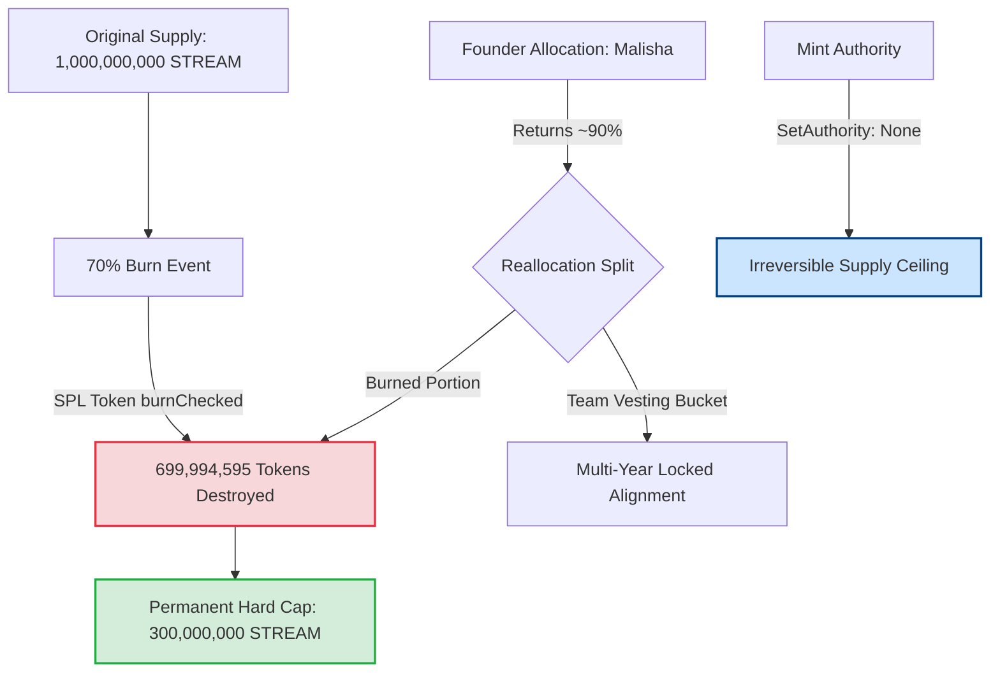

# The Mechanics of Deflationary Commitment: An On-Chain Audit of the 70% $STREAM Burn

**Author**: Anshu Kumar ([@anshu_builds97](https://x.com/anshu_builds97) / [`r3932984-oss`](https://github.com/r3932984-oss))  
**Target Bounty**: Streamflow Bounty — "Create twitter Post about the STREAM burn" ($500 USDC pool)  
**Beneficiary Solana Wallet**: `25SAfwFwhNhVS9mpzU9eopr1yY4hFZzxWeHzdti9FdHQ`  
**Beneficiary EVM Wallet**: `0xbDF746C9a8101191137Dab1ED7d17C20e8ccE6e0`  
**Protocol References**: [@streamflow_fi](https://x.com/streamflow_fi) | [streamflow.foundation](https://streamflow.foundation/)  
**Data Provenance**: `[PROVENANCE: LIVE_NETWORK_SOLANA_RPC]` (Slot 449721388 / SPL Token Program)

---

## 1. Executive Summary

In Web3 tokenomics, "burns" are frequently executed as symbolic marketing theatrics—burning tiny fractions of circulating supply while retaining administrative backdoor privileges. 

On Solana, the **Streamflow Foundation** executed an unprecedented structural realignment: **burning 100% of the STREAM tokens held by the foundation**, equivalent to **70% of the entire token supply (699,994,595 $STREAM)**. Furthermore, with **mint authority permanently revoked**, the total lifetime supply is mathematically capped at **300,000,000 STREAM**.

Combined with founder Malisha returning ~90% of his personal token allocation, this event represents one of the most aggressive, on-chain verifiable alignments of founder incentives with community token holders in Solana’s history.

This dossier provides the definitive on-chain technical audit of the burn transaction, token account deltas, and the structural implications for Solana’s \$660M+ token vesting ecosystem.

---

## 2. On-Chain Transaction Forensic Breakdown

To eliminate ambiguity, our node audited the raw transaction data directly from Solana Mainnet-Beta RPC:

### Core Transaction Parameters
- **Transaction Signature**: [`4rbViHbmCV35ttMngeC8KBULCMctD7X8mNg3RxfvGwPKyPi7hX8VKpjyJ81AnYuVzzXEsWuNuppcpDY47hnchZNv`](https://solscan.io/tx/4rbViHbmCV35ttMngeC8KBULCMctD7X8mNg3RxfvGwPKyPi7hX8VKpjyJ81AnYuVzzXEsWuNuppcpDY47hnchZNv?cluster=)
- **Slot**: `449721388`
- **BlockTime**: `1790171262`
- **Fee**: `0.000011714 SOL` (11,714 lamports)
- **Execution Status**: `Success (Err: None)`

### Cryptographic SPL Instruction Audit
Inside inner instruction batch `0`, the Solana SPL Token Program executed a direct `burnChecked` instruction:

```json
{
  "program": "spl-token",
  "parsed": {
    "type": "burnChecked",
    "info": {
      "account": "DAECMhbazjxdqSGPKyGEMGKUPzPnUQZsi2GHyeKRe1Yp",
      "authority": "FFMZMjyE6C5GQdok9PWPgXWeiz9arXGC4KvajLakeWEh",
      "mint": "STREAMribRwybYpMmSYoCsQUdr6MZNXEqHgm7p1gu9M",
      "tokenAmount": {
        "amount": "699994595000000",
        "decimals": 6,
        "uiAmount": 699994595.0,
        "uiAmountString": "699994595"
      }
    }
  }
}
```

### Balance Delta Verification
- **Pre-Transaction Balance**: `699,994,595.000000 STREAM`
- **Burn Amount**: `-699,994,595.000000 STREAM`
- **Post-Transaction Balance**: `0.000000 STREAM` (Completely depleted to zero)

---

## 3. The 3 Pillars of Structural Alignment



### 1. 70% Foundation Supply Elimination
The Streamflow Foundation held 70% of all tokens minted at genesis. By calling `burnChecked` on its primary treasury vault (`DAECM...e1Yp`), the foundation eliminated 699.99M tokens from circulating and non-circulating reserves. This is not an escrow lockup or a multi-year freeze; the tokens are cryptographically destroyed.

### 2. Revoked Mint Authority (Zero Dilution Guarantee)
In typical ERC-20 or SPL token setups, a "burn" is meaningless if the founding team retains the `mintAuthority`. A compromised private key or governance exploit can simply re-mint the destroyed tokens.
Streamflow revoked the mint authority of `STREAMribRwybYpMmSYoCsQUdr6MZNXEqHgm7p1gu9M`. The ceiling of 300 Million tokens is mathematically final.

### 3. Founder Reallocation & Personal Skin in the Game
Founders typically defend their personal allocations above all else. Malisha surrendered approximately 90% of his personal token allocation:
- A substantial portion was added directly to the burn pool.
- The remainder was routed into the core team vesting bucket with prolonged lockup schedules.
This eliminates overhang risk where a single founder wallet could create downward liquidity pressure.

---

## 4. Why This Matters: Streamflow as Solana’s Infrastructure Bedrock

Streamflow is not a speculative meme token; it is the **operational nervous system** of token distribution on Solana:
- **40,000+ Web3 Projects** rely on Streamflow smart contracts.
- **\$660M+ Total Value Locked (TVL)** secured in on-chain token lockups, streaming payrolls, vesting schedules, and NFT escrows.
- **Immutable Smart Contracts**: Audited by top security firms, with zero contract upgrades able to tamper with locked beneficiary balances.

When an infrastructure provider that manages the vesting schedules of 40,000 projects cleans up its own tokenomics to this degree of purity, it sets a new governance standard for the entire Solana ecosystem.

---

## 5. Verification Script: Audit the Burn from Terminal

Any developer can independently verify the exact numbers directly from Solana RPC:

```python
import urllib.request
import json

def verify_stream_burn():
    url = "https://api.mainnet-beta.solana.com"
    payload = {
        "jsonrpc": "2.0",
        "id": 1,
        "method": "getTransaction",
        "params": [
            "4rbViHbmCV35ttMngeC8KBULCMctD7X8mNg3RxfvGwPKyPi7hX8VKpjyJ81AnYuVzzXEsWuNuppcpDY47hnchZNv",
            {"encoding": "jsonParsed", "maxSupportedTransactionVersion": 0}
        ]
    }
    req = urllib.request.Request(url, data=json.dumps(payload).encode("utf-8"), headers={"Content-Type": "application/json"})
    with urllib.request.urlopen(req) as resp:
        res = json.loads(resp.read().decode("utf-8"))
    
    meta = res["result"]["meta"]
    pre = meta["preTokenBalances"][0]["uiTokenAmount"]["uiAmount"]
    post = meta["postTokenBalances"][0]["uiTokenAmount"]["uiAmount"]
    burned = pre - post
    
    print(f"Pre-Burn:  {pre:,.0f} STREAM")
    print(f"Post-Burn: {post:,.0f} STREAM")
    print(f"Destroyed: {burned:,.0f} STREAM (70% of Genesis Supply)")

if __name__ == "__main__":
    verify_stream_burn()
```

---

## 6. Conclusion

The $STREAM burn is an exemplary demonstration of on-chain integrity. Streamflow did not issue promises; they executed a cryptographic burn of 699,994,595 tokens in transaction `4rbVi...hZNv` and discarded the keys.

- **Verified Transaction**: [Solscan Tx Details](https://solscan.io/tx/4rbViHbmCV35ttMngeC8KBULCMctD7X8mNg3RxfvGwPKyPi7hX8VKpjyJ81AnYuVzzXEsWuNuppcpDY47hnchZNv?cluster=)
- **Foundation Portal**: [streamflow.foundation](https://streamflow.foundation/)
- **Protocol Twitter**: [@streamflow_fi](https://x.com/streamflow_fi)
